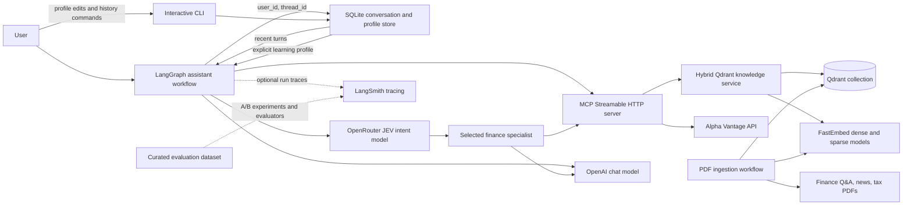

# Finance Assistant

Python services for finance data, PDF-based knowledge retrieval, and MCP tool
access. The project uses a `src/` layout; run Python modules with `PYTHONPATH=src`
from the repository root.

## Architecture

```text
src/
├── agents/       # Six specialist definitions and workflow router
├── core/         # Settings, errors, and SQLite conversation/profile storage
├── data/         # Finance API, Qdrant adapters, and source PDFs
├── mcp_server/   # MCP transport and tool registration
├── rag/          # PDF parsing and dense/sparse embedding models
├── utils/        # Shared logging configuration
├── web_app/      # Future user interface (not implemented yet)
└── workflow/     # Ingestion and LangGraph assistant workflow
tests/            # Unit tests
config.yaml       # Non-secret application defaults
requirements.txt  # Python dependencies
```

The MCP server exposes market data, portfolio analysis, and hybrid Qdrant
knowledge search. The LangGraph workflow routes each question to one of six
specialists: Finance Q&A, Portfolio Analysis, Market Analysis, Goal Planning,
News Synthesizer, or Tax Education. Each turn performs a routed RAG retrieval
before the specialist responds. The router and specialists use LangChain; the
specialists receive only their assigned MCP tools. Knowledge retrieval searches
the `text-dense` and
`text-sparse` vectors and fuses results with Qdrant Reciprocal Rank Fusion
(RRF). Search results are cached in memory for the configured TTL.

## High-Level Design (HLD)

### Purpose and scope

The application answers finance questions by routing each request to a
specialist, retrieving relevant PDF knowledge, and optionally calling external
finance tools through MCP. The current user-facing entry point is a command-line
workflow; a web application package is reserved for future UI work.

### System context



### Main runtime flow

1. The CLI identifies the request with a `user_id` and `thread_id`. These IDs
   select a profile and a conversation; they are labels, not authentication.
2. Before invoking the graph, the workflow loads the user's explicit profile
   and the configured number of latest turns for that thread from SQLite.
   The full transcript remains stored.
3. The dedicated Jev intent model receives the current question and recent
   conversation turns through OpenRouter's Decisions API. The workflow selects
   the highest-scoring specialist. The user's profile is supplied to the
   selected specialist as context for adapting explanations and goals-based
   guidance.
4. The workflow retrieves relevant Qdrant chunks using the current question
   and recent conversation context, filtered by the selected specialist's
   document type.
5. The specialist combines the question, retrieved knowledge, recent turns,
   and profile context. Its LangChain agent can call only its assigned MCP
   tools; the MCP server executes those finance or knowledge operations.
6. After a successful response, the workflow stores the question and answer
   under that user and thread in SQLite. Failed requests are not added as
   completed turns.
7. The user can explicitly view, update, or delete their profile and view or
   clear a conversation using CLI commands. Profile data is limited to
   learning level, explanation preferences, and financial goals; holdings
   and account details are not automatically retained.

The local interactive CLI resumes history when the same user and conversation
IDs are supplied after restarting. Choosing another conversation ID starts a
separate thread, while the user's profile remains shared across their threads.
The graph selects one specialist per question; it does not fan out to multiple
specialists or serve a web UI.

Conversation history and profile data are stored locally in the configured
SQLite database, independently from LangSmith traces. When tracing is enabled,
the model inputs can include recent turns and profile context; operators
should account for this data flow in their privacy and retention policies.

### Evaluation and observability

The LangGraph workflow supports optional LangSmith tracing through LangChain's
environment-based tracing integration. Set `LANGSMITH_TRACING=true` and provide
`LANGSMITH_API_KEY` to send runs to LangSmith. The root workflow run is named
`finance-assistant` and tagged `finance-assistant`; child graph nodes, model
calls, and tool calls are included in the trace. `LANGSMITH_PROJECT` selects
the destination project; the supplied `.env.example` sets it to
`finance-assistant`.

Offline evaluation should run separately from the interactive request path
against a curated, versioned dataset of finance questions and expected
behavior. Evaluators should measure:

- **Routing accuracy:** whether the router selects the intended specialist.
- **Retrieval quality:** whether retrieved chunks are relevant to the question
  and selected document type.
- **Answer quality:** relevance, groundedness in retrieved context, and
  appropriate handling of missing evidence.
- **Tool behavior:** whether the selected specialist invokes appropriate MCP
  tools with valid arguments when required.

Evaluation results can be compared across prompt, model, retrieval, and
workflow changes and used as a release-quality check. They should not block or
add latency to normal user requests. Traces can contain the user's question,
retrieved content, model output, and tool inputs/outputs. Do not send
personally identifiable information or financial account data to LangSmith
unless the project's privacy, consent, and retention policies permit it.

The evaluation harness creates or reuses the versioned
`finance-assistant-routing-v1` LangSmith dataset from
`src/evaluation/datasets/finance_router_v1.json`. It has twelve synthetic
queries covering all six specialists. Three evaluators record exact route
accuracy, non-empty answers, and rubric-based answer quality from the configured
OpenAI model. Experiment A uses the Jev Decisions API router; experiment B uses
an OpenAI structured-output router. Both use the same specialist answer model,
retrieval, MCP tools, dataset, and evaluators.

The initial 12-example run on 2026-10-29 completed both experiments. Both
variants achieved 100% route accuracy and 100% non-empty answers. The normalized
LLM-judge answer-quality scores were 0.850 for Jev and 0.883 for OpenAI. This
small synthetic dataset is a smoke-test baseline, not sufficient evidence that
one router is generally better; rerun after changes and expand the dataset for
release decisions.

- [Experiment A: Jev Decisions API](https://smith.langchain.com/o/3e206f05-13ed-4e56-bfc2-974149837580/projects/p/8eb1c334-c3b9-4bfd-bf23-af0943d8b982)
- [Experiment B: OpenAI structured router](https://smith.langchain.com/o/3e206f05-13ed-4e56-bfc2-974149837580/projects/p/38f47de2-d292-49f2-abbc-e9099f018f61)
- [Compare the two experiments](https://smith.langchain.com/o/3e206f05-13ed-4e56-bfc2-974149837580/datasets/6d6145db-993c-4304-b89a-1699a0d78e9c/compare?selectedSessions=8eb1c334-c3b9-4bfd-bf23-af0943d8b982%2C38f47de2-d292-49f2-abbc-e9099f018f61)

Run both experiments from the project root after starting the MCP server and
setting `LANGSMITH_API_KEY`, `OPENAI_API_KEY`, and `OPENROUTER_API_KEY` in the
local `.env`:

```bash
PYTHONPATH=src .venv/bin/python -m evaluation.langsmith_experiments
```

To create or reuse the LangSmith dataset without running model calls:

```bash
PYTHONPATH=src .venv/bin/python -m evaluation.langsmith_experiments --dataset-only
```

The script prints experiment URLs and a comparison URL. It runs one example at a
time to limit concurrent calls to external model and MCP services. Use only
synthetic evaluation queries; LangSmith traces can retain prompts, retrieved
content, tool inputs/outputs, and model answers. This baseline comparison
measures routing impact while keeping answer generation and supporting services
constant; market/news examples can still depend on external data availability.

### Deployment boundaries

- **Assistant workflow:** runs separately from the MCP server and connects to
  the configured Streamable HTTP endpoint (`MCP_SERVER_URL`).
- **MCP server:** exposes market-data, portfolio, and knowledge-search tools at
  `http://127.0.0.1:8000/mcp` by default.
- **Qdrant:** stores PDF chunks, payload metadata, and named dense/sparse
  vectors.
- **External services:** Alpha Vantage supplies market data; OpenAI supplies
  router and specialist model inference. LangSmith is an optional tracing
  service enabled with environment settings.
- **Ingestion:** a separately invoked batch workflow parses local PDFs,
  computes embeddings, and upserts points into Qdrant.

## Low-Level Design (LLD)

### Component responsibilities

| Component | Responsibility |
|---|---|
| `core/settings.py` | Loads `config.yaml`, `.env`, and environment overrides into cached typed settings. |
| `core/conversation_store.py` | Persists conversation turns and explicitly maintained learning profiles in SQLite. |
| `core/errors.py` | Defines the shared application exception base. |
| `agents/router.py` | Defines the structured route decision and routing instructions. |
| `agents/specialists.py` | Defines the six specialist identities, prompts, knowledge filters, and allowed MCP tool names. |
| `workflow/assistant.py` | Loads recent history and user profile, routes intent with the configured OpenRouter model, runs retrieval and specialist execution with the answer model, persists successful turns, and exposes the interactive CLI. |
| `mcp_server/server.py` | Registers MCP tools and serves them using Streamable HTTP. |
| `data/finance_api.py` | Validates finance API inputs, calls Alpha Vantage with retries, caching, and TLS verification; implements portfolio summary. |
| `data/knowledge_service.py` | Embeds query text, performs dense and sparse Qdrant prefetch, fuses ranks with RRF, and caches search results. |
| `rag/embedding.py` | Lazily initializes FastEmbed dense and SPLADE sparse models. |
| `rag/pdf_ingestion.py` | Parses and chunks finance, news, and tax PDFs with section metadata. |
| `workflow/ingestion.py` | Embeds PDF chunks, builds Qdrant points, creates the collection when missing, and uploads in batches. |
| `data/qdrant_cleanup.py` | Counts collection points by default and deletes only when explicitly confirmed. |

### LangGraph state and routing

The graph state is `AssistantState`:

| Field | Type | Meaning |
|---|---|---|
| `query` | `str` | User question for this invocation. |
| `route` | `str` | Selected `AgentType` value. |
| `retrieved_context` | `str` | Serialized result from the `search_knowledge` MCP tool. |
| `answer` | `str` | Specialist's final response. |
| `conversation_history` | `list[dict[str, str]]` | Recent user/assistant turns for the current user and conversation. |
| `user_profile` | `dict[str, Any]` | Explicit learning level, explanation preferences, and financial goals. |

Graph topology:

```text
START → router → retrieve_context → selected specialist → END
```

The router returns a `RouteDecision` with an agent enum value and rationale.
The retrieval node maps that agent to one or more `DocType` filters. Tool-enabled
specialists use LangChain `create_agent`; Finance Q&A and Tax Education call
the chat model directly after retrieval because they have no additional
specialist-specific MCP tools. All specialists still use the shared retrieval
tool before answering.

### Conversation history and user profiles

`core/conversation_store.py` stores successful user/assistant turns and
user-maintained profiles in `data/finance_assistant.sqlite3` by default.
`storage.sqlite_path` and `storage.history_turns` in `config.yaml` configure
the database location and how many recent turns are sent to the model. The
complete conversation remains stored; only the configured recent turns are
loaded into model context. Each turn is isolated by both `user_id` and
`thread_id`; profiles are isolated by `user_id`.

The profile contains only the fields the user explicitly enters: learning
level, explanation preferences, and financial goals. Holdings and account
details are not collected into the profile. In the CLI, `/profile` displays
the current profile, `/profile set` edits it, and `/profile delete` removes it.
`/history` displays the current conversation; `/clear-history` removes only
that conversation's turns. Reuse the same IDs to resume history; choose a new
conversation ID to begin a separate thread.

The CLI's IDs are organizational labels, not authentication. This local SQLite
implementation is intended for a single-user machine and does not provide
multi-user access control or database encryption. The database file is created
with owner-only permissions on supported systems and is ignored by Git. When
LangSmith tracing is enabled, model context can include prior turns and profile
fields, so consider disabling tracing for sensitive conversations.

### Specialist knowledge and tool mapping

| Specialist | Qdrant `DocType` filter | Additional MCP tools |
|---|---|---|
| Finance Q&A | `QAndA` | None |
| Portfolio Analysis | `QAndA` | `analyze_portfolio` |
| Market Analysis | `NewsSynthesiser`, `QAndA` | `get_stock_quote`, `get_company_overview`, `get_daily_stock_prices` |
| Goal Planning | `QAndA`, `TaxEducation` | `analyze_portfolio`, `get_stock_quote`, `get_company_overview` |
| News Synthesizer | `NewsSynthesiser` | `get_financial_news` |
| Tax Education | `TaxEducation` | None |

The tool list is loaded dynamically from MCP when the graph is built. Startup
fails with an explicit error if the required retrieval tool or a specialist's
declared tool is unavailable.

### Hybrid retrieval and RRF

`data/knowledge_service.py` embeds the normalized query with the same dense and
sparse embedding helpers used during document ingestion. It issues two
prefetches against Qdrant's named vectors:

- `text-dense`: dense vector similarity.
- `text-sparse`: SPLADE sparse vector similarity.

The candidates are fused with Qdrant's RRF query and then limited to the
requested result count. Optional `doc_types` are applied as a Qdrant `DocType`
payload filter. Returned results contain the chunk text, fused score, and
metadata; internal embedding-input text is excluded from returned metadata.

Searches use a process-local LRU-style cache with a configurable TTL and
maximum number of entries. Cache keys include collection, query, document-type
filter, and result limit. Cached values are deep-copied to prevent callers from
mutating shared cache entries. The cache is not shared across server processes.

### Qdrant document schema

Each ingested point has a deterministic UUID, two named vectors, and a payload:

```text
Point
├── id: UUIDv5(document identity)
├── vector
│   ├── text-dense: 1024-dimensional vector
│   └── text-sparse: {indices, values}
└── payload
    ├── DocType: QAndA | NewsSynthesiser | TaxEducation
    ├── combined_text: retrieved chunk
    └── document, section, keyword, and page metadata
```

The ingestion workflow creates the `FinAi` collection if absent, configures
cosine distance for the 1024-dimensional dense vector, configures a sparse
vector index, creates a keyword index for `DocType`, and upserts chunks in
batches. Existing collections are not recreated or automatically migrated.

### Configuration and secrets

`core/settings.py` loads non-secret defaults from `config.yaml` and lets
environment variables override supported values. Secrets are read from
environment variables or the local, ignored `.env` file; they must not be
stored in `config.yaml` or committed. Important settings include:

- Model and MCP endpoint: `OPENAI_MODEL`, `MCP_SERVER_URL`.
- Specialist response model: `OPENAI_API_KEY`, `OPENAI_MODEL`.
- Specialist intent router: `OPENROUTER_API_KEY`; the model and API base URL
  are set under `router` in `config.yaml` and can be overridden with
  `OPENROUTER_MODEL` and `OPENROUTER_BASE_URL`.
- Credentials: `OPENAI_API_KEY`, `ALPHA_VANTAGE_API_KEY`.
- Optional tracing: enable `langsmith.tracing` in `config.yaml`, or override
  it with `LANGSMITH_TRACING`; provide `LANGSMITH_API_KEY` in `.env`.
  Project and endpoint defaults are configured under `langsmith` in
  `config.yaml` and can be overridden with `LANGSMITH_PROJECT` and
  `LANGSMITH_ENDPOINT`.
- Qdrant: `QDRANT_URL`, `QDRANT_API_KEY`, `QDRANT_COLLECTION`.
- Embeddings: `DENSE_EMBEDDING_MODEL`, `SPARSE_EMBEDDING_MODEL`.
- Retrieval cache and limits: `SEARCH_CACHE_TTL_SECONDS`,
  `SEARCH_CACHE_MAX_ENTRIES`, `SEARCH_MAX_RESULTS`.
- Conversation persistence: `CONVERSATION_DB_PATH`,
  `CONVERSATION_HISTORY_TURNS`.

### Reliability, security, and limitations

- Alpha Vantage requests use verified TLS, bounded retries, timeouts, input
  validation, and response caching.
- Qdrant and API errors are raised with operation-specific context rather than
  silently returning empty success-shaped results.
- Logging is configured to write to the console; the application does not
  currently configure persistent log files.
- Finance responses are informational, not investment, legal, or tax advice.
- MCP transport defaults to local Streamable HTTP. Production deployments
  should configure authentication, network controls, and TLS termination.
- Current unit tests cover workflow routing/retrieval, tool assignment,
  hybrid RRF query construction/cache behavior, settings overrides, and
  ingestion point conversion. Live OpenAI, Alpha Vantage, and Qdrant integration
  tests require explicit service credentials and are not run by the unit suite.

## Setup

```sh
python3 -m venv .venv
.venv/bin/python -m pip install -r requirements.txt
cp .env.example .env
```

Add credentials and service URLs to `.env`:

- `ALPHA_VANTAGE_API_KEY` for market-data tools.
- `QDRANT_URL` and `QDRANT_API_KEY` for knowledge search and ingestion.
- `OPENAI_API_KEY` for specialist responses. `OPENAI_MODEL`
  selects the specialist response model.
- `OPENROUTER_API_KEY` for the dedicated intent router. The default router
  model is `~typesafe/jev-latest`; configure `router.model` in `config.yaml` or
  `OPENROUTER_MODEL` if your OpenRouter account uses a different model ID.
- Optional LangSmith tracing: set `langsmith.tracing: true` in `config.yaml`
  and provide your `LANGSMITH_API_KEY` in `.env`. The config sets project and
  endpoint defaults; environment variables can override them. Tracing is
  disabled by setting `langsmith.tracing: false` or `LANGSMITH_TRACING=false`.

Never commit `.env` or real credentials. Non-secret defaults, such as model
names, collection name, retrieval limits, and logging level, live in
`config.yaml`. Environment variables override supported settings.

## Run the MCP server

```sh
PYTHONPATH=src .venv/bin/python -m mcp_server.server
```

The Streamable HTTP endpoint is `http://127.0.0.1:8000/mcp`. The server remains
running while clients connect. In VS Code, start the **Python: Debug MCP
server** launch configuration, then connect to the `finance-assistant` server
in `.vscode/mcp.json`.

## Run the LangGraph assistant

Start the MCP server first, then in another terminal run:

```sh
PYTHONPATH=src .venv/bin/python -m workflow.assistant
```

The CLI asks for a user ID and conversation ID; accept the defaults to resume
the default local conversation, or use distinct IDs for separate users and
threads. It then accepts questions until `/quit`. Use `/profile`, `/profile set`,
`/profile delete`, `/history`, and `/clear-history` to manage saved data.
The workflow connects to `MCP_SERVER_URL`, retrieves relevant knowledge, and
uses recent conversation history for intent routing and specialist context,
and uses the explicit profile for specialist personalization. Market,
portfolio, and news specialists may call only their assigned MCP tools. It
requires `OPENAI_API_KEY` and `OPENROUTER_API_KEY`; data-dependent MCP tools
also require their API/Qdrant configuration.

### Manually test persistent conversation history

1. Start the MCP server and assistant. When prompted, use a test user ID such
   as `history-test-user` and conversation ID `history-test-thread`.
2. Ask: `I am learning about retirement accounts. Explain a Roth IRA simply.`
   Wait for the assistant's answer.
3. Ask a follow-up that relies on the earlier turn:
   `Compare that with a traditional IRA, and remind me which account I asked about first.`
   The answer should use the current question and earlier conversation context.
4. Enter `/history`. Both completed question/answer pairs should be listed.
5. Enter `/quit`, restart the assistant, and enter the **same** user and
   conversation IDs. Enter `/history`; the turns should still be there. Ask
   another follow-up to check that the prior turns are passed back as context.
6. Quit and restart with the same user ID but a different conversation ID.
   `/history` should report no saved turns for that thread.

To check persistence and isolation without making model or MCP calls, run the
store unit tests:

```sh
PYTHONPATH=src .venv/bin/python -m unittest tests.test_conversation_store -v
```

The test verifies that turns survive reopening the SQLite database, stay
scoped to the requested user and conversation IDs, and can be cleared per
conversation. The workflow tests also check that prior turns and explicit
profile fields are included in model context.

## Ingest the PDF knowledge base

The ingestion workflow reads `financeQnA.pdf`, `News_Systhesizer.pdf`, and
`tax_education.pdf` from `src/data/`, creates embeddings, and upserts chunks
into Qdrant. It can create the configured collection if it does not exist.

```sh
PYTHONPATH=src .venv/bin/python -m workflow.ingestion
```

To count points before deleting them, run:

```sh
PYTHONPATH=src .venv/bin/python -m data.qdrant_cleanup
```

Deletion requires the explicit `--confirm` option.

## Tests

Run the unit tests without external API requests or Qdrant credentials:

```sh
PYTHONPATH=src .venv/bin/python -m unittest discover -s tests -v
```
