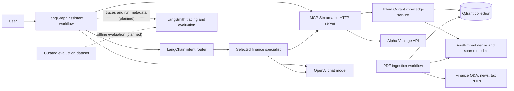

# Finance Assistant

Python services for finance data, PDF-based knowledge retrieval, and MCP tool
access. The project uses a `src/` layout; run Python modules with `PYTHONPATH=src`
from the repository root.

## Architecture

```text
src/
├── agents/       # Six specialist definitions and workflow router
├── core/         # Shared settings and application errors
├── data/         # Finance API, Qdrant adapters, and source PDFs
├── mcp_server/   # MCP transport and tool registration
├── rag/          # PDF parsing and dense/sparse embedding models
├── utils/        # Shared logging configuration
├── web_app/      # Future user interface (not implemented yet)
└── workflow/     # Ingestion and LangGraph assistant workflow
tests/            # Unit tests
config.yaml       # Non-secret application defaults
requirements.txt  # Python dependencies
```

The MCP server exposes market data, portfolio analysis, and hybrid Qdrant
knowledge search. The LangGraph workflow routes each question to one of six
specialists: Finance Q&A, Portfolio Analysis, Market Analysis, Goal Planning,
News Synthesizer, or Tax Education. Each turn performs a routed RAG retrieval
before the specialist responds. The router and specialists use LangChain; the
specialists receive only their assigned MCP tools. Knowledge retrieval searches
the `text-dense` and
`text-sparse` vectors and fuses results with Qdrant Reciprocal Rank Fusion
(RRF). Search results are cached in memory for the configured TTL.

## High-Level Design (HLD)

### Purpose and scope

The application answers finance questions by routing each request to a
specialist, retrieving relevant PDF knowledge, and optionally calling external
finance tools through MCP. The current user-facing entry point is a command-line
workflow; a web application package is reserved for future UI work.

### System context



### Main runtime flow

1. The workflow receives one user question.
2. The router uses structured LLM output to select exactly one specialist.
3. The workflow retrieves relevant chunks from Qdrant, filtered by the
   selected specialist's document type.
4. The selected specialist combines the question and retrieved context. Its
   LangChain agent can call only the MCP tools assigned to that specialist.
5. The MCP server executes the selected finance or knowledge operation.
6. The specialist returns a response to the workflow and then to the caller.

The current CLI accepts and answers a single question per process invocation.
The LangGraph currently selects one specialist per question; it does not yet
fan out to multiple specialists or serve a web UI.

### Evaluation and observability (planned)

LangSmith is the proposed observability and evaluation layer for the LangChain
and LangGraph workflow. When enabled, trace records should capture the route
decision, selected specialist, retrieval inputs/results, MCP tool calls, model
runs, and final response. Tracing should be controlled by environment
configuration and disabled by default unless an operator explicitly enables
it.

Offline evaluation should run separately from the interactive request path
against a curated, versioned dataset of finance questions and expected
behavior. Evaluators should measure:

- **Routing accuracy:** whether the router selects the intended specialist.
- **Retrieval quality:** whether retrieved chunks are relevant to the question
  and selected document type.
- **Answer quality:** relevance, groundedness in retrieved context, and
  appropriate handling of missing evidence.
- **Tool behavior:** whether the selected specialist invokes appropriate MCP
  tools with valid arguments when required.

Evaluation results can be compared across prompt, model, retrieval, and
workflow changes and used as a release-quality check. They should not block or
add latency to normal user requests. Dataset examples and traces must avoid
unnecessary personally identifiable information or financial account data;
only send data to LangSmith under the project's approved privacy and retention
policy.

**Implementation status:** LangSmith tracing, datasets, and evaluators are not
currently configured in this repository. The diagram shows the planned
integration, not a currently active service connection. Enabling it will
require explicit LangSmith credentials/configuration and an evaluation
dataset.

### Deployment boundaries

- **Assistant workflow:** runs separately from the MCP server and connects to
  the configured Streamable HTTP endpoint (`MCP_SERVER_URL`).
- **MCP server:** exposes market-data, portfolio, and knowledge-search tools at
  `http://127.0.0.1:8000/mcp` by default.
- **Qdrant:** stores PDF chunks, payload metadata, and named dense/sparse
  vectors.
- **External services:** Alpha Vantage supplies market data; OpenAI supplies
  router and specialist model inference. LangSmith is a planned optional
  tracing/evaluation service and is not currently connected.
- **Ingestion:** a separately invoked batch workflow parses local PDFs,
  computes embeddings, and upserts points into Qdrant.

## Low-Level Design (LLD)

### Component responsibilities

| Component | Responsibility |
|---|---|
| `core/settings.py` | Loads `config.yaml`, `.env`, and environment overrides into cached typed settings. |
| `core/errors.py` | Defines the shared application exception base. |
| `agents/router.py` | Defines the structured route decision and routing instructions. |
| `agents/specialists.py` | Defines the six specialist identities, prompts, knowledge filters, and allowed MCP tool names. |
| `workflow/assistant.py` | Connects to MCP, builds specialist agents and the LangGraph, performs route → retrieval → specialist execution, and exposes the CLI. |
| `mcp_server/server.py` | Registers MCP tools and serves them using Streamable HTTP. |
| `data/finance_api.py` | Validates finance API inputs, calls Alpha Vantage with retries, caching, and TLS verification; implements portfolio summary. |
| `data/knowledge_service.py` | Embeds query text, performs dense and sparse Qdrant prefetch, fuses ranks with RRF, and caches search results. |
| `rag/embedding.py` | Lazily initializes FastEmbed dense and SPLADE sparse models. |
| `rag/pdf_ingestion.py` | Parses and chunks finance, news, and tax PDFs with section metadata. |
| `workflow/ingestion.py` | Embeds PDF chunks, builds Qdrant points, creates the collection when missing, and uploads in batches. |
| `data/qdrant_cleanup.py` | Counts collection points by default and deletes only when explicitly confirmed. |

### LangGraph state and routing

The graph state is `AssistantState`:

| Field | Type | Meaning |
|---|---|---|
| `query` | `str` | User question for this invocation. |
| `route` | `str` | Selected `AgentType` value. |
| `retrieved_context` | `str` | Serialized result from the `search_knowledge` MCP tool. |
| `answer` | `str` | Specialist's final response. |

Graph topology:

```text
START → router → retrieve_context → selected specialist → END
```

The router returns a `RouteDecision` with an agent enum value and rationale.
The retrieval node maps that agent to one or more `DocType` filters. Tool-enabled
specialists use LangChain `create_agent`; Finance Q&A and Tax Education call
the chat model directly after retrieval because they have no additional
specialist-specific MCP tools. All specialists still use the shared retrieval
tool before answering.

### Specialist knowledge and tool mapping

| Specialist | Qdrant `DocType` filter | Additional MCP tools |
|---|---|---|
| Finance Q&A | `QAndA` | None |
| Portfolio Analysis | `QAndA` | `analyze_portfolio` |
| Market Analysis | `NewsSynthesiser`, `QAndA` | `get_stock_quote`, `get_company_overview`, `get_daily_stock_prices` |
| Goal Planning | `QAndA`, `TaxEducation` | `analyze_portfolio`, `get_stock_quote`, `get_company_overview` |
| News Synthesizer | `NewsSynthesiser` | `get_financial_news` |
| Tax Education | `TaxEducation` | None |

The tool list is loaded dynamically from MCP when the graph is built. Startup
fails with an explicit error if the required retrieval tool or a specialist's
declared tool is unavailable.

### Hybrid retrieval and RRF

`data/knowledge_service.py` embeds the normalized query with the same dense and
sparse embedding helpers used during document ingestion. It issues two
prefetches against Qdrant's named vectors:

- `text-dense`: dense vector similarity.
- `text-sparse`: SPLADE sparse vector similarity.

The candidates are fused with Qdrant's RRF query and then limited to the
requested result count. Optional `doc_types` are applied as a Qdrant `DocType`
payload filter. Returned results contain the chunk text, fused score, and
metadata; internal embedding-input text is excluded from returned metadata.

Searches use a process-local LRU-style cache with a configurable TTL and
maximum number of entries. Cache keys include collection, query, document-type
filter, and result limit. Cached values are deep-copied to prevent callers from
mutating shared cache entries. The cache is not shared across server processes.

### Qdrant document schema

Each ingested point has a deterministic UUID, two named vectors, and a payload:

```text
Point
├── id: UUIDv5(document identity)
├── vector
│   ├── text-dense: 1024-dimensional vector
│   └── text-sparse: {indices, values}
└── payload
    ├── DocType: QAndA | NewsSynthesiser | TaxEducation
    ├── combined_text: retrieved chunk
    └── document, section, keyword, and page metadata
```

The ingestion workflow creates the `FinAi` collection if absent, configures
cosine distance for the 1024-dimensional dense vector, configures a sparse
vector index, creates a keyword index for `DocType`, and upserts chunks in
batches. Existing collections are not recreated or automatically migrated.

### Configuration and secrets

`core/settings.py` loads non-secret defaults from `config.yaml` and lets
environment variables override supported values. Secrets are read from
environment variables or the local, ignored `.env` file; they must not be
stored in `config.yaml` or committed. Important settings include:

- Model and MCP endpoint: `OPENAI_MODEL`, `MCP_SERVER_URL`.
- Credentials: `OPENAI_API_KEY`, `ALPHA_VANTAGE_API_KEY`.
- Qdrant: `QDRANT_URL`, `QDRANT_API_KEY`, `QDRANT_COLLECTION`.
- Embeddings: `DENSE_EMBEDDING_MODEL`, `SPARSE_EMBEDDING_MODEL`.
- Retrieval cache and limits: `SEARCH_CACHE_TTL_SECONDS`,
  `SEARCH_CACHE_MAX_ENTRIES`, `SEARCH_MAX_RESULTS`.

### Reliability, security, and limitations

- Alpha Vantage requests use verified TLS, bounded retries, timeouts, input
  validation, and response caching.
- Qdrant and API errors are raised with operation-specific context rather than
  silently returning empty success-shaped results.
- Logging is configured to write to the console; the application does not
  currently configure persistent log files.
- Finance responses are informational, not investment, legal, or tax advice.
- MCP transport defaults to local Streamable HTTP. Production deployments
  should configure authentication, network controls, and TLS termination.
- Current unit tests cover workflow routing/retrieval, tool assignment,
  hybrid RRF query construction/cache behavior, settings overrides, and
  ingestion point conversion. Live OpenAI, Alpha Vantage, and Qdrant integration
  tests require explicit service credentials and are not run by the unit suite.

## Setup

```sh
python3 -m venv .venv
.venv/bin/python -m pip install -r requirements.txt
cp .env.example .env
```

Add credentials and service URLs to `.env`:

- `ALPHA_VANTAGE_API_KEY` for market-data tools.
- `QDRANT_URL` and `QDRANT_API_KEY` for knowledge search and ingestion.
- `OPENAI_API_KEY` for the LangChain router and specialist agents. `OPENAI_MODEL`
  selects the chat model.

Never commit `.env` or real credentials. Non-secret defaults, such as model
names, collection name, retrieval limits, and logging level, live in
`config.yaml`. Environment variables override supported settings.

## Run the MCP server

```sh
PYTHONPATH=src .venv/bin/python -m mcp_server.server
```

The Streamable HTTP endpoint is `http://127.0.0.1:8000/mcp`. The server remains
running while clients connect. In VS Code, start the **Python: Debug MCP
server** launch configuration, then connect to the `finance-assistant` server
in `.vscode/mcp.json`.

## Run the LangGraph assistant

Start the MCP server first, then in another terminal run:

```sh
PYTHONPATH=src .venv/bin/python -m workflow.assistant
```

The workflow connects to the MCP Streamable HTTP endpoint at
`MCP_SERVER_URL`, retrieves relevant knowledge for the selected specialist,
and returns its answer. Market, portfolio, and news specialists may call only
their assigned MCP tools. It requires `OPENAI_API_KEY`; data-dependent MCP tools
also require their API/Qdrant configuration.

## Ingest the PDF knowledge base

The ingestion workflow reads `financeQnA.pdf`, `News_Systhesizer.pdf`, and
`tax_education.pdf` from `src/data/`, creates embeddings, and upserts chunks
into Qdrant. It can create the configured collection if it does not exist.

```sh
PYTHONPATH=src .venv/bin/python -m workflow.ingestion
```

To count points before deleting them, run:

```sh
PYTHONPATH=src .venv/bin/python -m data.qdrant_cleanup
```

Deletion requires the explicit `--confirm` option.

## Tests

Run the unit tests without external API requests or Qdrant credentials:

```sh
PYTHONPATH=src .venv/bin/python -m unittest discover -s tests -v
```
